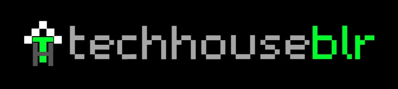

  

  An open source community from Bangalore. We build things in the open and invite others to build with us.

  <a href="https://www.techhouseblr.com">Website</a> ·
  <a href="https://x.com/TechHouseBlr">X</a>

Tech House BLR brings builders, designers, thinkers and tinkerers together to turn ideas into things people can use. We share what we learn and improve each other's work.

## Projects

- **[Meshwav](https://github.com/tech-house-blr/meshwav)**: private, low-latency audio between your own devices over Tailscale. Work in progress.
- **[Mesh Pilot](https://github.com/tech-house-blr/meshpilot)**: an open-source, self-hosted console to discover, monitor and control devices across your private mesh VPN. Work in progress.
- **[CTF Army Knife](https://github.com/tech-house-blr/ctf-army-knife)**: a Swiss army knife for CTFs.

More on the [projects page](https://www.techhouseblr.com/projects).

## Build with us

You don't need a finished idea to join a conversation. Bring a problem, a sketch, a prototype, or a willingness to help. We work across engineering, design, product, security and community.

Start at [Build With Us](https://www.techhouseblr.com/build-with-us), or say hello on the [Contact](https://www.techhouseblr.com/contact) page.
